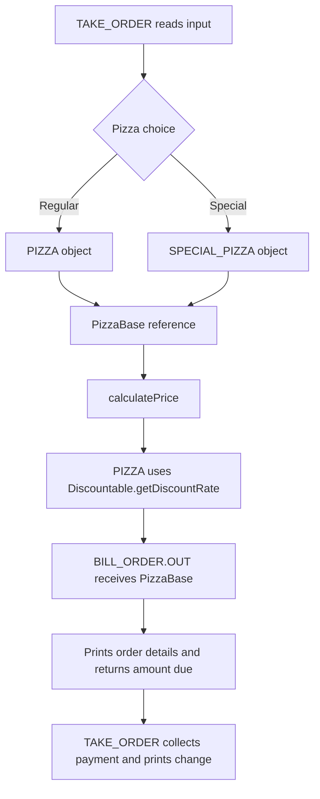
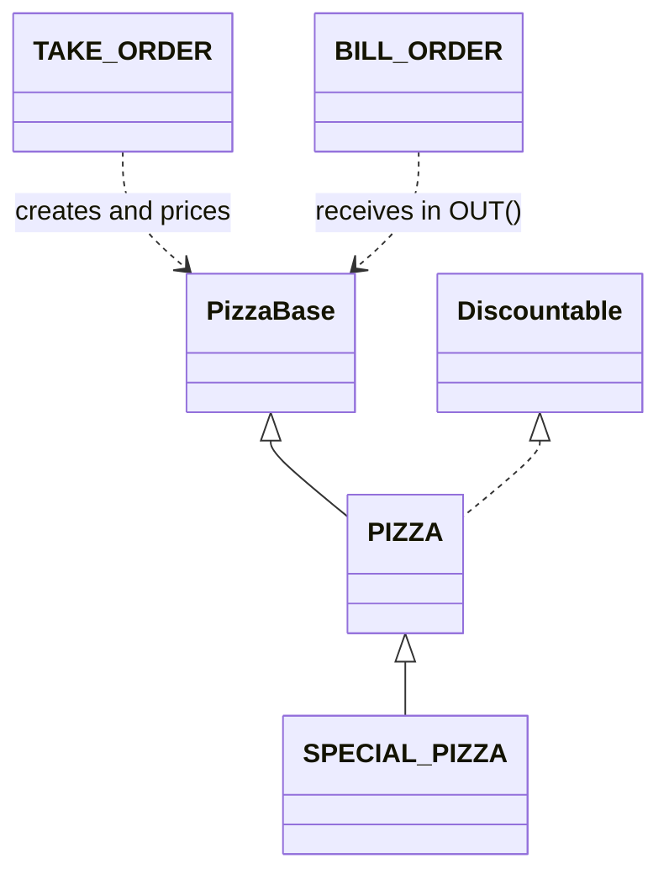

# PIZZA ORDERING SYSTEM

A simple Java-based Pizza Ordering and Billing System built to demonstrate the required **Object-Oriented Programming (OOP)** concepts in a clear and organized way.

---

## Project Approach:

The program is separated into small classes so that each class has one main responsibility.

| File | Purpose |
|---|---|
| `PizzaBase.java` | Abstract base class for pizza objects |
| `Discountable.java` | Defines discount-related behavior |
| `PIZZA.java` | Stores pizza data, validation, pricing, getters, and setters |
| `SPECIAL_PIZZA.java` | Extends `PIZZA` and adds special pricing behavior |
| `BILL_ORDER.java` | Displays order details and returns the amount due |
| `TAKE_ORDER.java` | Handles user input, object creation, payment, and change |

This approach keeps the program organized and avoids placing all logic inside `main()`.

---

## OOP Concepts Used:

The project demonstrates:

- **Classes and Objects**
- **Encapsulation**
- **Getters and Setters**
- **Abstraction**
- **Abstract Classes**
- **Interfaces**
- **Inheritance**
- **Method Overriding**
- **Polymorphism**
- **Object Passing**
- **Input Validation**

---

## Pricing Flow:

`PIZZA.calculatePrice()` calculates the regular pizza price with this formula:

```text
base total × (1 - discount rate)
```

The base total is `(topping price + diameter in cm × PHP 5.00) × quantity`.

`PIZZA` converts the diameter from inches to centimeters with this factor:

```text
1 inch = 2.54 centimeters
```

The size charge is PHP 5.00 per centimeter. `SPECIAL_PIZZA.calculatePrice()` adds PHP 50.00 per pizza after the regular price and discount.

Prices are rounded to two decimal places and stored before billing. Special orders store the total including the surcharge. Invalid numeric input is requested again, payment must be finite and greater than the rounded amount due, and the program exits when input ends.

## Order and class flow:

The classes pass the selected pizza through the order and billing steps:



`TAKE_ORDER` stores the chosen object in a `PizzaBase` variable. The object is either a `PIZZA` or a `SPECIAL_PIZZA`. Both inherit from `PizzaBase`, so `TAKE_ORDER` can call `calculatePrice()` through the shared abstract type.

`PIZZA` also implements `Discountable`. Its `getDiscountRate()` method returns 20% for `Senior Citizen`, 12% for `VIPCard`, and 0% for `No Discount`. `PIZZA.calculatePrice()` applies that rate to the regular total. `SPECIAL_PIZZA` overrides `calculatePrice()`, calls the parent calculation, then adds PHP 50.00 for each pizza.

After pricing, `TAKE_ORDER` passes the same `PizzaBase` object to `BILL_ORDER.OUT()`. `BILL_ORDER` casts it to `PIZZA` to read the toppings, size, quantity, discount, and price. It prints the order details and returns the amount due. `TAKE_ORDER` then checks the payment amount and prints the change.

The class relationships are:



---

## Project Structure:

```text
PizzaActivity/
├── PizzaBase.java
├── Discountable.java
├── PIZZA.java
├── SPECIAL_PIZZA.java
├── BILL_ORDER.java
├── TAKE_ORDER.java
└── README.md
```

---

## Compile and Run:

Open a terminal inside the project folder.

```bash
javac *.java
java TAKE_ORDER
```

All source files are kept in the same folder, so no package declaration is required for this project.
